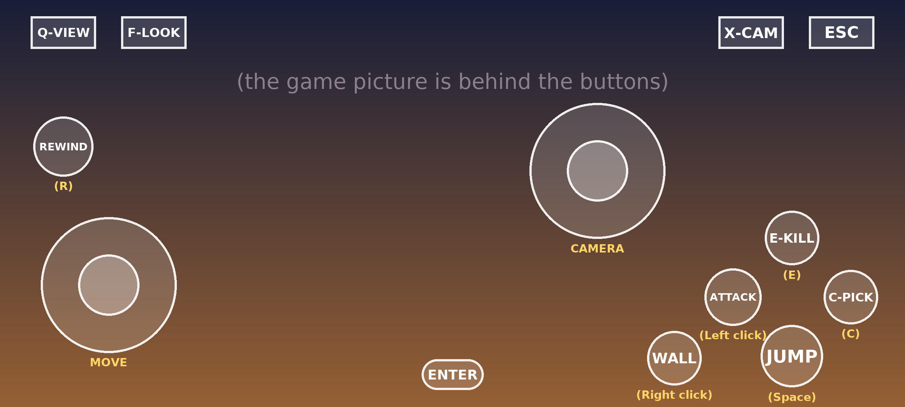

# Prince of Persia: The Two Thrones on Android

_Simple step-by-step guide - Winlator 11.2 - October 2026_

> ❗ **Can this game become an Android APK?**
>
> **No.** This is a Windows PC game from 2005. It is made only of Windows program files (.exe and .dll), and there is no source code. So nobody can convert it into a real Android APK.
>
> **But you CAN play it on your phone.** Winlator is a free Android app (an APK) that runs Windows games. You install Winlator, copy the game folder to your phone, and start the game inside Winlator. This guide shows every step.

**Files I added to the game folder for you:**

- **00 ANDROID - PLAY GAME.bat** - starts the game with one tap. It also sets the registry keys that the game needs.
- **00 ANDROID - touch controls.icp** - on-screen touch buttons made for this game.
- **00 ANDROID - HOW TO PLAY (guide)** - this guide.

## What you need

- An Android phone with a 64-bit processor. **Snapdragon** phones (Adreno graphics) work best. Other phones (MediaTek, Exynos, Google Tensor) can also work.
- **4 GB RAM** or more (6 - 8 GB is better).
- About **5 GB of free space**. The game is about 1.5 GB.
- Optional: a **Bluetooth game controller**. It makes the game much easier to play.

## Step 1 - Install Winlator

1. On your phone, open: <https://github.com/brunodev85/winlator/releases>
2. Under **Assets**, tap **Winlator_11.2.apk** (about 157 MB) to download it. If you see a newer version, take the newest one.
3. Open the downloaded file and tap **Install**. If Android asks, allow **Install unknown apps**.
4. Open Winlator and wait until **Installing System Files...** is finished.

> ⚠️ **Be careful**
>
> Download Winlator only from the GitHub page above. Many "Prince of Persia APK" files on other websites are fake or contain viruses.

## Step 2 - Copy the game to your phone

The game folder is **princ of percia** in your Google Drive (about 1.5 GB). Copy the whole folder to your phone.

**Way A - with a computer (easiest)**

1. On the computer, open <https://drive.google.com>
2. Right-click the folder **princ of percia** and choose **Download**. Google makes a .zip file (a big folder can become 2 zip files).
3. Connect your phone with a USB cable. Copy the zip file(s) into the phone's **Download** folder.

**Way B - phone only**

1. Open **Chrome** and go to drive.google.com. Tap **⋮** (the three dots, top right) and turn on **Desktop site**.
2. Long-press the folder **princ of percia** and choose **Download**.

**Then unzip it**

1. Open the zip file with a file app, for example **Files by Google** or **ZArchiver**, and tap **Extract**. If there are 2 zip files, extract both into the same place.
2. Check that the game files are here: **Internal storage > Download > princ of percia > PrinceOfPersia.exe, pop3.exe, pop3.bf ...**
3. If you see a **princ of percia** folder inside another **princ of percia** folder, move the inner one up into **Download**.

> 💡 **Good to know**
>
> Winlator shows your **Download** folder as drive **D:**. So the game will be at **D:\princ of percia**.

## Step 3 - Create a container (a small "Windows PC" inside Winlator)

1. Open Winlator. Tap **☰** (menu) > **Containers** > **+** (add).
2. Set these options:

| Setting | Choose this |
|---|---|
| Name | Prince of Persia |
| Screen Size | **1280x720 (16:9)**. Older or slower phone: **854x480 (16:9)** |
| Wine Version | Leave it as it is |
| Graphics Driver | **Vulkan: Turnip** - Snapdragon phones. **Vulkan: Vortek** - all other phones. Leave **OpenGL** as it is. |
| DX Wrapper | **Direct3D: DXVK**. Then tap the settings button on the **Direct3D** row: **Frame Rate = 60** (very important). Keep **Version** as it is. Tap **OK**. Leave **DirectX 12** as it is. |
| Audio Driver | **ALSA** (if you have no sound later: **PulseAudio**) |
| HUD Mode | **Simple FPS** (optional - shows the game speed) |
| Advanced tab > Box64 Preset | **Performance** (if the game crashes: **Intermediate**, then **Stability**) |

3. Tap **✓** to save. Wait until the container is ready.

> ❗ **Why Frame Rate 60?**
>
> This game has bugs above 60 FPS: it can freeze on loading screens, jumps can fail, and the sound can go out of sync. Frame Rate 60 stops this.

## Step 4 - Add the touch controls

1. In Winlator, tap **☰** > **Input Controls**.
2. Tap the **Import** button > **Open File**.
3. Go to **Download > princ of percia** and choose **00 ANDROID - touch controls.icp**.
4. The profile **Prince of Persia - The Two Thrones** is now in the list.

## Step 5 - Start the game

1. Tap **☰** > **Containers**. Next to **Prince of Persia**, tap **⋮** (three dots) > **File Manager**.
2. Open **D:**, then open **princ of percia** (tap the folder icon or its **Open** button).
3. Find **00 ANDROID - PLAY GAME.bat** and tap its **Run** button (or its icon). A black window shows for a moment, then the game launcher opens.
4. Tap **Play** in the launcher. The first time, the launcher checks the system - just wait a few seconds.

> 💡 **Faster next time**
>
> Tap **⋮** (three dots) next to **00 ANDROID - PLAY GAME.bat** > **Add to Favorites**. Next time open **File Manager > Favorites** and tap it.

## Step 6 - Show the buttons on the screen

1. While the game is running, press your phone's **Back** button (or swipe in from the left edge). The Winlator menu opens.
2. Tap **Input Controls**, choose **Prince of Persia - The Two Thrones**, turn on **Show Touchscreen Controls**, and tap **OK**.
3. The first time, the game asks for a **player name**. Open the Winlator menu again > **Keyboard**, type a name, and press **Enter**.

## Step 7 - Settings inside the game (Options)

- **Graphics - Basic > Resolution:** the same as your container (for example 1280x720), or the closest one.
- **Graphics - Advanced > V-Sync:** On.
- If the game is slow: **Shadow Effects** low or off, **Water Effects** off.

## The touch buttons

_Yellow text = notes for you. It is not shown in the game._

| Button | What it does | PC key |
|---|---|---|
| MOVE (left stick) | Walk and run. Also moves in menus. | W A S D |
| CAMERA (right stick) | Turns the camera. | Mouse |
| JUMP | Jump, roll, climb up. | Space |
| ATTACK | Dagger attack, finish a Speed Kill. | Left mouse |
| E-KILL | Start a Speed Kill, use the second weapon, grab. | E |
| C-PICK | Pick up or throw a weapon, climb down. | C |
| WALL | Run on walls, swing on bars, push / pull, drink water, block. | Right mouse |
| REWIND | Hold = rewind time. Tap = slow motion. | R |
| F-LOOK | Look around (first-person view). | F |
| Q-VIEW | Wide view of the area. | Q |
| X-CAM | Put the camera behind the Prince. | X |
| ESC | Pause menu / go back. | Esc |
| ENTER | OK / select in menus. | Enter |

- The game's help messages show **PC keys** (for example "Space" or "E"). Use the table to find the button.
- In menus: choose with the **MOVE** stick, press **ENTER** to select, **ESC** to go back.
- You can also swipe on an empty part of the screen to turn the camera. (A short tap on an empty part = attack.)
- To move or resize buttons: **☰ > Input Controls** > choose the profile > **Controls Editor**.
- Camera too slow or too fast? **☰ > Input Controls** > change **Cursor Speed**.

## Playing with a game controller (optional)

1. Pair the controller in Android **Settings > Bluetooth** first.
2. Start the game. In the game, open **Options > Controls - Gamepad** and set the buttons you like.
3. If the game does not react to the controller: open the container settings > **Wine Configuration** > **DirectInput Mapper Type** and try the other choice.
4. On Xbox-style controllers this game cannot use the two triggers (LT / RT) correctly. Put important actions on other buttons.

## Problems and fixes

"DXVK settings" = container settings > **DX Wrapper** > the settings button on the **Direct3D** row.

| Problem | Try this |
|---|---|
| Black screen, or the game closes at the start | DXVK settings > **Version 1.10.3** (or 1.7.2). Or switch the **Vulkan** driver (Turnip <> Vortek). Or **Box64 Preset: Intermediate**, then **Stability**. |
| The launcher says your video card is not supported | DXVK settings > **Custom Device** > choose an NVIDIA card, for example **NVIDIA GeForce GTX 480**. |
| Freezes on a loading screen, jumps fail, sound is out of sync | Check DXVK settings > **Frame Rate = 60**. In the game, turn **V-Sync** on. |
| The game is slow | **Screen Size 854x480** or **800x600** (and the same resolution in the game). Turn off shadows and water effects. Close other apps. |
| No sound, or crackling sound | **Audio Driver: PulseAudio**. |
| The camera turns by itself, or does not turn | Container settings > **Wine Configuration > Mouse Warp Override > Force** (or Enable). Or, while playing: Winlator menu > **Input Controls** > turn on **Relative Mouse Movement**. |
| Nothing happens when you tap the .bat file | Tap **RUN THIS FIX FIRST.bat** once. Wait 30 seconds, then close it. Now tap **PrinceOfPersia.exe** to play. |
| "PrinceOfPersia.exe was not found" | The .bat file must stay inside the game folder, next to PrinceOfPersia.exe. |

## Good to know

- Your **saved games** are kept inside the game folder (Download > princ of percia). Do not delete this folder.
- Players report: **Snapdragon 8 Elite** - stable 60 FPS. **Snapdragon 870** - playable. Even a mid-range **MediaTek Helio G99** phone (8 GB RAM) was playable at 800x600 in a test.
- You can ignore these files on the phone: "Launch Prince of Persia The Two Thrones.lnk", "AnkerGames - Free Pre-installed PC Games.url", "Read Me.txt".
- More help about Winlator: <https://github.com/brunodev85/winlator>

---

### Files in this folder (for developers)

- `winlator/00 ANDROID - touch controls.icp` - Winlator input-controls profile (import in **Input Controls > Import > Open File**).
- `winlator/00 ANDROID - PLAY GAME.bat` - one-tap start script: writes the launcher's registry keys, then starts `PrinceOfPersia.exe`.
- `tools/make_controls.py` - generates the `.icp` (validated against Winlator's binding names, overlap-checked for 16:9 - 21:9 screens) and the preview image.
- `tools/build_guide.py` - builds this README and the Word/Google Docs guide from one source.
- `docs/` - generated guide (`.docx`) and layout preview.

The game files themselves are **not** in this repository.
